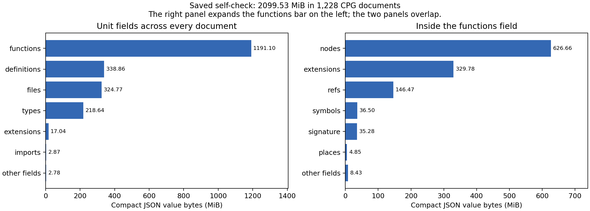
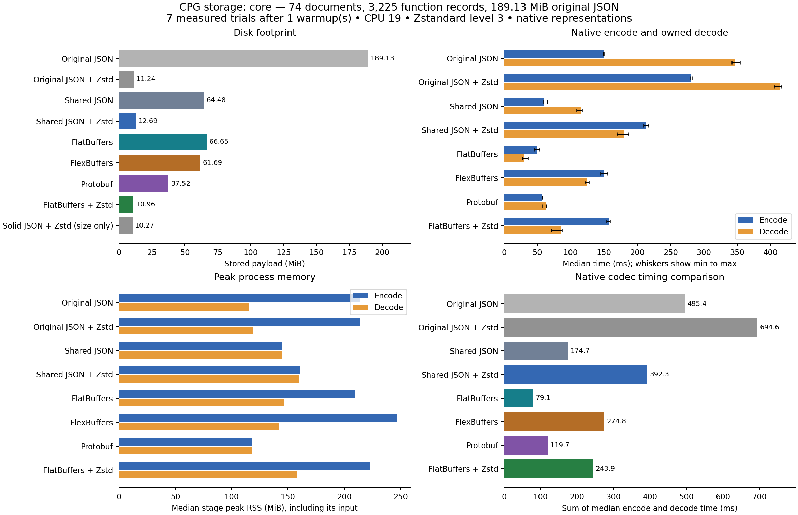
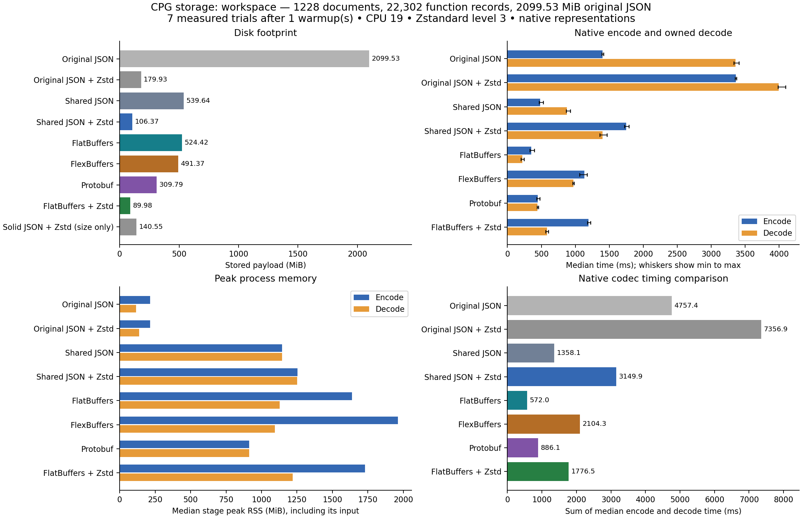

# CPG storage benchmark comparison

This study compares a lossless shared-table representation of fresh rstyle CPG output in JSON, FlatBuffers, FlexBuffers, and Protobuf. JSON and the fastest uncompressed binary codec are also tested with Zstandard level 3. Original JSON is timed both plain and compressed, using the producer's JSON-tree encoder and the existing typed CPG reader model. All variants appear in the native timing rank. The production CPG writer and readers are unchanged.

**FlatBuffers is fastest for encode plus full owned decoding in every measured dataset. FlatBuffers + Zstd has the smallest payload among timed variants in every dataset.** Compare those results with both direct original-JSON compression controls before choosing a production storage layout; the solid-array control has no timed reader.

## Input and source provenance

The producer was built from `feat/cpg-document-routes` at `88adc9968b7f29d9699a7dec1274dc684c74ac25`. The source inventory SHA256 is `6f7c30b792a9c20d172c1e8e321142afe72d17d162d5cba3e4c47cc355ddebbe`. `producer.json` records the exact binary hashes and dirty file inventory; the local artifact directory also retains the source patch, untracked-source archive, frozen binaries, captured documents, and capture logs.

Input is a fresh default style self-check of the full rstyle workspace (no --all-targets), run with frozen binaries from feat/cpg-document-routes at 88adc996. The core dataset includes every batched document from the rstyle-core compilation; workspace includes all 1,228 saved documents across six compilation units. These are real capture files, with no synthetic repetition. The earlier cpg emit study uses a different source snapshot and route and remains separately reported. PLAN.md was the only untracked file; tracked source files were clean before and after capture.

## Saved self-check size breakdown

The complete saved run occupies **2,230,451,182 bytes**. Its **1,228 CPG documents occupy 2,201,518,061 bytes (2099.53 MiB)**. All document sizes and XXH3-64 seals matched their 6 publication manifests. Build-cache files are outside this run and excluded. This reproduces the current self-check route; the earlier 3.1 GB capture is unavailable, so its exact contents remain unknown.

The capture batches consecutive function owners from the same source file, up to 256 owners per batch. Each batch builds unit tables for its functions, so source records, definitions, and types recur across documents. It also records generated owners and compiler observations that `cpg emit` does not retain. The style summary measured 11,013 authored functions; the saved documents contain 22,302 function records. The earlier emit study contained 11,016 function records, so the size difference combines extra content with repeated tables. It cannot be attributed to serialization alone.

| Compilation target | Documents | Function records | CPG MiB |
| --- | ---: | ---: | ---: |
| rstyle_pdg | 876 | 14,231 | 1502.51 |
| cargo-rstyle | 158 | 3,180 | 272.76 |
| rstyle_core | 74 | 3,225 | 189.13 |
| rstyle-driver | 103 | 912 | 100.60 |
| rstyle_ccgraph | 14 | 415 | 17.38 |
| rstyle_extraction_fixtures | 3 | 339 | 17.15 |

| Unit field | Compact JSON MiB | Fraction of actual CPG bytes |
| --- | ---: | ---: |
| functions | 1191.10 | 56.7% |
| definitions | 338.86 | 16.1% |
| files | 324.77 | 15.5% |
| types | 218.64 | 10.4% |
| extensions | 17.04 | 0.8% |
| imports | 2.87 | 0.1% |
| configuration | 1.55 | 0.1% |
| namespaces | 0.63 | 0.0% |
| target | 0.19 | 0.0% |
| toolchain | 0.14 | 0.0% |
| semantics | 0.11 | 0.0% |
| root_file | 0.04 | 0.0% |
| id | 0.04 | 0.0% |
| language | 0.04 | 0.0% |
| values | 0.03 | 0.0% |
| instances | 0.00 | 0.0% |

Functions also carry their own graphs and compiler observations. These rows break down the functions field above and must not be added to it:

| Function field | Compact JSON MiB | Fraction of actual CPG bytes |
| --- | ---: | ---: |
| nodes | 626.66 | 29.8% |
| extensions | 329.78 | 15.7% |
| refs | 146.47 | 7.0% |
| symbols | 36.50 | 1.7% |
| signature | 35.28 | 1.7% |
| places | 4.85 | 0.2% |
| name | 1.94 | 0.1% |
| span | 1.89 | 0.1% |
| definition | 1.51 | 0.1% |
| id | 1.49 | 0.1% |
| cfg | 0.83 | 0.0% |
| implements | 0.46 | 0.0% |
| root | 0.23 | 0.0% |
| accesses | 0.04 | 0.0% |
| values | 0.04 | 0.0% |

Within function extensions:

| Extension | Compact JSON MiB | Fraction of actual CPG bytes |
| --- | ---: | ---: |
| rust:call-instances | 319.29 | 15.2% |
| rust:node-observations | 6.15 | 0.3% |
| rust:source-scan | 2.90 | 0.1% |
| rust:trait-members | 0.19 | 0.0% |
| rust:generated-source | 0.02 | 0.0% |

Across files, definitions, types, values, imports, namespaces, and instances, **734.17 MiB (35.0% of the capture)** consists of repeated exact record contents beyond the first occurrence. This is a logical compact-JSON byte estimate, not an independently measured archive format or a guarantee of production savings. It excludes array separators, references needed by a shared layout, and additional sharing inside records. Field sizes exclude document wrappers and field names; actual file sizes are measured separately.

`capture-inventory.json` retains the file inventory, unit counts, field byte estimates, table record counts, input SHA256 values, and seal verification results.

## Core results

The 74 input document(s) contain **3,225 function records** and **187,729 syntax nodes**. Their original JSON occupies **198,314,842 bytes (189.13 MiB)**.

**FlatBuffers has the lowest measured encode plus owned-decode time among the binary formats.** Adding Zstandard produces 10.96 MiB, 94.2% below the original JSON payload. The smallest tested shared representation is FlatBuffers + Zstd at 10.96 MiB.

| Time rank | Representation | Payload MiB | Encode ms | Decode ms | Encode plus decode ms | Encode peak MiB | Decode peak MiB |
| ---: | --- | ---: | ---: | ---: | ---: | ---: | ---: |
| 1 | FlatBuffers | 66.65 | 49.36 | 29.78 | 79.14 | 209.32 | 146.64 |
| 2 | Protobuf | 37.52 | 56.95 | 62.70 | 119.66 | 117.69 | 117.64 |
| 3 | Shared JSON | 64.48 | 59.56 | 115.18 | 174.74 | 144.64 | 144.62 |
| 4 | FlatBuffers + Zstd | 10.96 | 157.83 | 86.03 | 243.86 | 223.29 | 157.89 |
| 5 | FlexBuffers | 61.69 | 150.38 | 124.42 | 274.80 | 246.36 | 141.68 |
| 6 | Shared JSON + Zstd | 12.69 | 212.43 | 179.88 | 392.30 | 160.45 | 159.43 |
| 7 | Original JSON | 189.13 | 149.39 | 345.97 | 495.36 | 213.95 | 114.92 |
| 8 | Original JSON + Zstd | 11.24 | 280.83 | 413.76 | 694.60 | 214.19 | 119.07 |

Times and memory values are medians. The JSON records retain every sample, minimum, maximum, and median absolute deviation. Original JSON encodes the producer's JSON trees and decodes into the existing typed CPG Document model, one document at a time. Shared variants encode and decode an interned arena. These ranks compare native representations of the same content; normalization and conversion into analysis types are excluded.

**Original JSON ranks 7 of 8 by encode plus decode; original JSON + Zstandard ranks 8 of 8.**

The normalization step, including input I/O, hashing, statistics, and exact reconstruction checks, took 3.110 s and reached 524.29 MiB process peak RSS. It is a separate one-time prototype cost, excluded from the per-codec timings.

### Sharing observed

The source contains 7,384,955 JSON value occurrences, represented by 1,067,617 distinct arena values. Repeated string and object-key bytes total 148.89 MiB before interning and 12.70 MiB afterward. These are logical byte counts, not independently compressed sizes or heap estimates.

| Unit table | Record occurrences | Exact distinct record contents |
| --- | ---: | ---: |
| definitions | 29,149 | 11,637 |
| files | 489 | 72 |
| imports | 855 | 855 |
| namespaces | 331 | 331 |
| types | 39,757 | 19,087 |
| values | 40 | 26 |

Compared with direct compression of the original JSON, FlatBuffers + Zstandard uses 0.975 times the storage. This control matters: shared records and binary encoding do not guarantee a smaller compressed file than repetitive JSON.

A separate **size-only** control compresses an array of all unchanged original JSON documents in one Zstandard frame: **10.27 MiB**. The timed original-JSON + Zstandard variant keeps one frame per document. This extra control isolates compression-boundary effects and is not included in the timing rank; no typed streaming reader for the solid array was benchmarked. Its decompressed array bytes were SHA256-verified.

## Workspace results

The 1228 input document(s) contain **22,302 function records** and **1,530,272 syntax nodes**. Their original JSON occupies **2,201,518,061 bytes (2099.53 MiB)**.

**FlatBuffers has the lowest measured encode plus owned-decode time among the binary formats.** Adding Zstandard produces 89.98 MiB, 95.7% below the original JSON payload. The smallest tested shared representation is FlatBuffers + Zstd at 89.98 MiB.

| Time rank | Representation | Payload MiB | Encode ms | Decode ms | Encode plus decode ms | Encode peak MiB | Decode peak MiB |
| ---: | --- | ---: | ---: | ---: | ---: | ---: | ---: |
| 1 | FlatBuffers | 524.42 | 352.86 | 219.14 | 572.01 | 1636.98 | 1128.40 |
| 2 | Protobuf | 309.79 | 445.10 | 440.95 | 886.06 | 913.89 | 913.88 |
| 3 | Shared JSON | 539.64 | 481.92 | 876.21 | 1358.13 | 1143.76 | 1143.82 |
| 4 | FlatBuffers + Zstd | 89.98 | 1193.12 | 583.42 | 1776.54 | 1729.56 | 1218.66 |
| 5 | FlexBuffers | 491.37 | 1132.05 | 972.26 | 2104.31 | 1960.57 | 1095.36 |
| 6 | Shared JSON + Zstd | 106.37 | 1747.92 | 1401.95 | 3149.87 | 1253.26 | 1252.37 |
| 7 | Original JSON | 2099.53 | 1398.65 | 3358.71 | 4757.37 | 214.32 | 115.31 |
| 8 | Original JSON + Zstd | 179.93 | 3365.20 | 3991.69 | 7356.90 | 214.58 | 136.96 |

Times and memory values are medians. The JSON records retain every sample, minimum, maximum, and median absolute deviation. Original JSON encodes the producer's JSON trees and decodes into the existing typed CPG Document model, one document at a time. Shared variants encode and decode an interned arena. These ranks compare native representations of the same content; normalization and conversion into analysis types are excluded.

**Original JSON ranks 7 of 8 by encode plus decode; original JSON + Zstandard ranks 8 of 8.**

The normalization step, including input I/O, hashing, statistics, and exact reconstruction checks, took 34.738 s and reached 1994.31 MiB process peak RSS. It is a separate one-time prototype cost, excluded from the per-codec timings.

### Sharing observed

The source contains 69,065,012 JSON value occurrences, represented by 8,367,554 distinct arena values. Repeated string and object-key bytes total 1718.81 MiB before interning and 92.57 MiB afterward. These are logical byte counts, not independently compressed sizes or heap estimates.

| Unit table | Record occurrences | Exact distinct record contents |
| --- | ---: | ---: |
| definitions | 412,172 | 69,796 |
| files | 32,564 | 1,263 |
| imports | 9,679 | 9,679 |
| namespaces | 2,975 | 2,975 |
| types | 547,377 | 122,597 |
| values | 224 | 92 |

Compared with direct compression of the original JSON, FlatBuffers + Zstandard uses 0.500 times the storage. This control matters: shared records and binary encoding do not guarantee a smaller compressed file than repetitive JSON.

A separate **size-only** control compresses an array of all unchanged original JSON documents in one Zstandard frame: **140.55 MiB**. The timed original-JSON + Zstandard variant keeps one frame per document. This extra control isolates compression-boundary effects and is not included in the timing rank; no typed streaming reader for the solid array was benchmarked. Its decompressed array bytes were SHA256-verified.

## Method and practical limits

- Every shared-arena codec receives identical strings, scalar values, child references, and document roots. The prototype interns exact strings and JSON substructures into a shared arena. It does not merge compiler entities by display name or discard observations, provenance, source text, or unknown fields.
- Original JSON uses serde_json::Value serialization as the actual producer does, and deserializes with the existing rstyle-core CPG Document model imported directly from its source file, whose hash is recorded. It processes one document at a time and sums codec time across documents. Its peak RSS is the maximum document-stage peak. Typed documents are kept alive through the timing boundary and destroyed afterward. The strict typed decoder must succeed. A separate generic parse checks canonical wire-document SHA256 outside timing after the typed output is dropped; it is not part of the reported decode time.
- Preparation reconstructs every original JSON document and checks semantic JSON equality. Shared results are checked with a SHA256 over every materialized arena field against the prepared model. Original JSON results are checked against a separately computed canonical document inventory. Original document SHA256 values and deterministic wire hashes are retained.
- Seven measured repetitions follow one warmup. Format order is randomized with seed 20261105. Each encode and decode runs in a separate optimized Rust process pinned to CPU 19. The host is shared; cgroup CPU and memory counters are retained. Whiskers show the observed range, not a confidence interval.
- Fastest means the lowest sum of median encode time and median full owned-decode time among FlatBuffers, FlexBuffers, and Protobuf. The winning codec is then measured with compression in additional trials. Read-heavy workloads can choose a different weighting.
- Timings cover encoding to owned wire buffers and decoding to each representation's fully owned output. File I/O, loading the common model, normalization, digest calculation, validation, and buffer destruction are outside those intervals. Compressed variants include the compression/decompression stage. This is not an end-to-end compiler or rstyle-analysis benchmark.
- The overall rank compares native representations of the same CPG information: original typed documents versus an interned shared arena. It includes representation and codec effects. Preparation is excluded for both; no claim is made that the existing analysis can consume the arena without additional integration. The separate binary winner selection remains restricted to the three uncompressed binary codecs.
- All compression uses Zstandard level 3 with one thread. Rust codecs use zstd 0.14.3 with libzstd 1.5.7. The original-JSON size control uses python-zstandard 0.25.0 with the same libzstd version, one independent frame per original document, and verified byte-for-byte reconstruction. A second size-only control uses one frame over a JSON array of the unchanged documents and verifies its decompressed SHA256; it has no timed reader.
- Stage peak RSS is sampled from Linux VmHWM after resetting the high-water mark with clear_refs=5. It includes the loaded common model for encode, or wire buffer for decode. Preparation peaks are reported separately and can exceed codec peaks. Extra retained allocator memory and builder capacity remain part of process RSS.
- FlatBuffers uses generated vectors of fixed-size arena value structs and transfers its native builder buffer without an added full-buffer copy. Protobuf uses prost messages with packed child IDs. FlexBuffers uses its Rust Serde serializer with default key sharing. JSON uses compact value tuples. No binary codec wraps JSON bytes. Pinned versions and schemas accompany the harness.
- Shared-format results apply to this common lossless arena and Rust implementations. A domain-specific typed binary CPG schema, native zero-copy access, independently compressed function chunks, other languages, different compression levels, and on-disk query indexes are not measured here. The current archive is monolithic; production chunking and bounded-memory normalization need a separate design.

For the batched self-check route, shared unit/source tables with independently addressable function chunks are a useful next design experiment: they directly target the repeated records without requiring a single whole-run archive. The current results do not establish that layout's size or reader performance. The production writer should be evaluated emitting shared records directly, because the separately measured post-processing normalization cost can exceed the codec savings on a single write/read cycle.

## Reproduction and retained measurements

See [the benchmark instructions](../../README.md) for build, capture, trial, and report commands. `measurements.csv` contains medians, ranges, median absolute deviations, sizes, and memory peaks. `raw/<dataset>/trials.jsonl` contains every warmup and measured operation. `raw/<dataset>/results.json` retains input hashes, environment, selection, and all aggregate samples. The HTML report works offline, and PNG/SVG charts are included for sharing.
