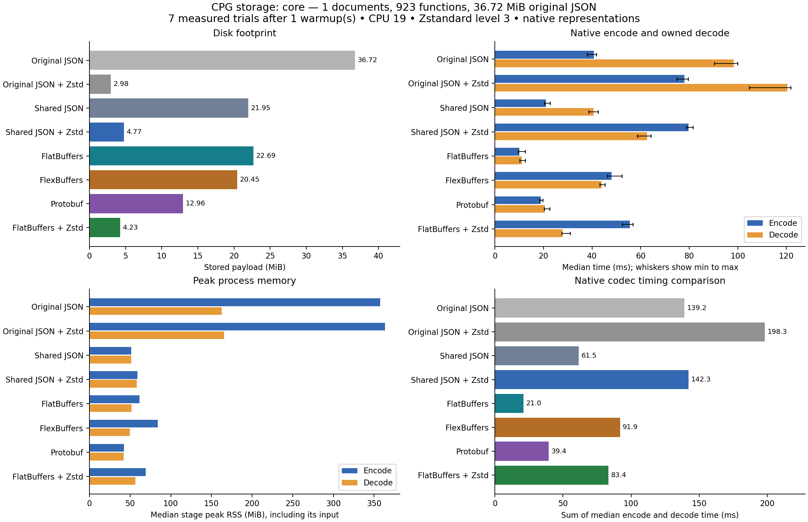
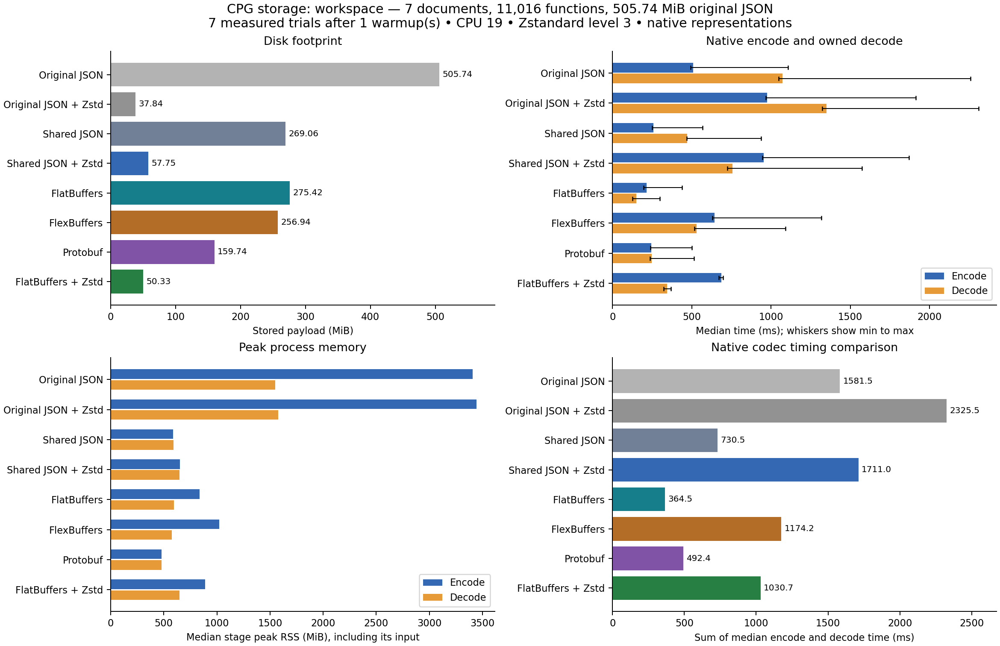

# CPG storage benchmark comparison

This study compares a lossless shared-table representation of fresh rstyle CPG output in JSON, FlatBuffers, FlexBuffers, and Protobuf. JSON and the fastest uncompressed binary codec are also tested with Zstandard level 3. Original JSON is now timed both plain and compressed, using the producer's JSON-tree encoder and the existing typed CPG reader model. All variants appear in the native timing rank. The production CPG writer and readers are unchanged.

**FlatBuffers is fastest for encode plus full owned decoding in every measured dataset. Direct Zstandard compression of the original JSON gives the smallest payloads.** The shared arena reduces uncompressed storage, but its extra references and record tuples do not improve compressed size over that simple control. For the current disk-space goal, direct compression is the first production experiment to pursue; the fastest binary codec remains a candidate for a reader designed to consume the shared arena directly.

## Input and source provenance

The producer was built from `feat/cpg-document-routes` at `c0aaaedf30c32ece4e7b52ecca7ba7d4cace4a12` with local changes. The source inventory SHA256 is `a461076a209ebb34780410e40ff8283c3149fd22ca00dc9efeeca3572169f968`. `producer.json` records the exact binary hashes and dirty file inventory; the local artifact directory also retains the source patch, untracked-source archive, frozen binaries, emitted documents, and emit logs.

Input is a fresh `cpg emit` over the actual workspace. The core dataset is its real rstyle-core compilation document; the workspace dataset contains all seven emitted documents. Neither dataset is synthetic or duplicated to manufacture scale. Private Cargo build artifacts are excluded. These inputs do not establish a byte breakdown for the previously estimated 3.1 GB capture.

## Core results

The 1 input document(s) contain **923 functions** and **59,923 syntax nodes**. Their original JSON occupies **38,499,607 bytes (36.72 MiB)**.

**FlatBuffers has the lowest measured encode plus owned-decode time among the binary formats.** Adding Zstandard produces 4.23 MiB, 88.5% below the original JSON payload. The smallest tested shared representation is FlatBuffers + Zstd at 4.23 MiB.

| Time rank | Representation | Payload MiB | Encode ms | Decode ms | Encode plus decode ms | Encode peak MiB | Decode peak MiB |
| ---: | --- | ---: | ---: | ---: | ---: | ---: | ---: |
| 1 | FlatBuffers | 22.69 | 10.00 | 11.01 | 21.00 | 61.66 | 51.84 |
| 2 | Protobuf | 12.96 | 18.88 | 20.54 | 39.42 | 42.30 | 42.21 |
| 3 | Shared JSON | 21.95 | 20.98 | 40.56 | 61.55 | 51.30 | 51.28 |
| 4 | FlatBuffers + Zstd | 4.23 | 55.60 | 27.85 | 83.44 | 69.29 | 56.32 |
| 5 | FlexBuffers | 20.45 | 48.07 | 43.86 | 91.94 | 84.17 | 49.60 |
| 6 | Original JSON | 36.72 | 40.79 | 98.40 | 139.18 | 357.41 | 162.52 |
| 7 | Shared JSON + Zstd | 4.77 | 79.65 | 62.66 | 142.31 | 59.20 | 58.16 |
| 8 | Original JSON + Zstd | 2.98 | 77.94 | 120.37 | 198.31 | 363.62 | 165.73 |

Times and memory values are medians. The JSON records retain every sample, minimum, maximum, and median absolute deviation. Original JSON encodes the producer's JSON trees and decodes into the existing typed CPG Document model, one document at a time. Shared variants encode and decode an interned arena. These ranks compare native representations of the same content; normalization and conversion into analysis types are excluded.

**Original JSON ranks 6 of 8 by encode plus decode; original JSON + Zstandard ranks 8 of 8.**

The normalization step, including input I/O, hashing, statistics, and exact reconstruction checks, took 1.910 s and reached 693.29 MiB process peak RSS. It is a separate one-time prototype cost, excluded from the per-codec timings.

### Sharing observed

The source contains 1,626,053 JSON value occurrences, represented by 387,008 distinct arena values. Repeated string and object-key bytes total 28.04 MiB before interning and 4.02 MiB afterward. These are logical byte counts, not independently compressed sizes or heap estimates.

| Unit table | Record occurrences | Exact distinct record contents |
| --- | ---: | ---: |
| definitions | 3,935 | 3,935 |
| files | 72 | 72 |
| imports | 855 | 855 |
| namespaces | 331 | 331 |
| types | 8,531 | 8,531 |
| values | 26 | 26 |

Compared with direct compression of the original JSON, FlatBuffers + Zstandard uses 1.420 times the storage. This control matters: shared records and binary encoding do not guarantee a smaller compressed file than repetitive JSON.

## Workspace results

The 7 input document(s) contain **11,016 functions** and **827,278 syntax nodes**. Their original JSON occupies **530,305,917 bytes (505.74 MiB)**.

**FlatBuffers has the lowest measured encode plus owned-decode time among the binary formats.** Adding Zstandard produces 50.33 MiB, 90.0% below the original JSON payload. The smallest tested shared representation is FlatBuffers + Zstd at 50.33 MiB.

| Time rank | Representation | Payload MiB | Encode ms | Decode ms | Encode plus decode ms | Encode peak MiB | Decode peak MiB |
| ---: | --- | ---: | ---: | ---: | ---: | ---: | ---: |
| 1 | FlatBuffers | 275.42 | 215.16 | 149.31 | 364.47 | 836.98 | 595.46 |
| 2 | Protobuf | 159.74 | 244.85 | 247.56 | 492.40 | 479.92 | 479.91 |
| 3 | Shared JSON | 269.06 | 259.53 | 470.98 | 730.50 | 589.25 | 589.32 |
| 4 | FlatBuffers + Zstd | 50.33 | 686.07 | 344.64 | 1030.71 | 889.96 | 646.07 |
| 5 | FlexBuffers | 256.94 | 644.29 | 529.95 | 1174.24 | 1021.67 | 576.99 |
| 6 | Original JSON | 505.74 | 508.15 | 1073.32 | 1581.47 | 3407.62 | 1549.04 |
| 7 | Shared JSON + Zstd | 57.75 | 954.97 | 756.08 | 1711.05 | 650.29 | 649.20 |
| 8 | Original JSON + Zstd | 37.84 | 974.23 | 1351.27 | 2325.51 | 3445.27 | 1576.14 |

Times and memory values are medians. The JSON records retain every sample, minimum, maximum, and median absolute deviation. Original JSON encodes the producer's JSON trees and decodes into the existing typed CPG Document model, one document at a time. Shared variants encode and decode an interned arena. These ranks compare native representations of the same content; normalization and conversion into analysis types are excluded.

**Original JSON ranks 6 of 8 by encode plus decode; original JSON + Zstandard ranks 8 of 8.**

The normalization step, including input I/O, hashing, statistics, and exact reconstruction checks, took 11.039 s and reached 6856.48 MiB process peak RSS. It is a separate one-time prototype cost, excluded from the per-codec timings.

### Sharing observed

The source contains 21,492,755 JSON value occurrences, represented by 4,524,680 distinct arena values. Repeated string and object-key bytes total 391.21 MiB before interning and 47.50 MiB afterward. These are logical byte counts, not independently compressed sizes or heap estimates.

| Unit table | Record occurrences | Exact distinct record contents |
| --- | ---: | ---: |
| definitions | 35,953 | 33,653 |
| files | 1,264 | 1,264 |
| imports | 9,682 | 9,682 |
| namespaces | 2,976 | 2,976 |
| types | 78,910 | 73,614 |
| values | 94 | 92 |

Compared with direct compression of the original JSON, FlatBuffers + Zstandard uses 1.330 times the storage. This control matters: shared records and binary encoding do not guarantee a smaller compressed file than repetitive JSON.

## Method and practical limits

- Every shared-arena codec receives identical strings, scalar values, child references, and document roots. The prototype interns exact strings and JSON substructures into a shared arena. It does not merge compiler entities by display name or discard observations, provenance, source text, or unknown fields.
- Original JSON uses serde_json::Value serialization as the actual producer does, and deserializes with the existing rstyle-core CPG Document model imported directly from its source file, whose hash is recorded. It processes one document at a time and sums codec time across documents. Its peak RSS is the maximum document-stage peak. Typed documents are kept alive through the timing boundary and destroyed afterward. The strict typed decoder must succeed. A separate generic parse checks canonical wire-document SHA256 outside timing after the typed output is dropped; it is not part of the reported decode time.
- Preparation reconstructs every original JSON document and checks semantic JSON equality. Shared results are checked with a SHA256 over every materialized arena field against the prepared model. Original JSON results are checked against a separately computed canonical document inventory. Original document SHA256 values and deterministic wire hashes are retained.
- Seven measured repetitions follow one warmup. Format order is randomized with seed 20261105. Each encode and decode runs in a separate optimized Rust process pinned to CPU 19. The host is shared; cgroup CPU and memory counters are retained. Whiskers show the observed range, not a confidence interval.
- Fastest means the lowest sum of median encode time and median full owned-decode time among FlatBuffers, FlexBuffers, and Protobuf. The winning codec is then measured with compression in additional trials. Read-heavy workloads can choose a different weighting.
- Timings cover encoding to owned wire buffers and decoding to each representation's fully owned output. File I/O, loading the common model, normalization, digest calculation, validation, and buffer destruction are outside those intervals. Compressed variants include the compression/decompression stage. This is not an end-to-end compiler or rstyle-analysis benchmark.
- The overall rank compares native representations of the same CPG information: original typed documents versus an interned shared arena. It includes representation and codec effects. Preparation is excluded for both; no claim is made that the existing analysis can consume the arena without additional integration. The separate binary winner selection remains restricted to the three uncompressed binary codecs.
- All compression uses Zstandard level 3 with one thread. Rust codecs use zstd 0.14.3 with libzstd 1.5.7. The original-JSON size control uses python-zstandard 0.25.0 with the same libzstd version, one independent frame per original document, and verified byte-for-byte reconstruction.
- Stage peak RSS is sampled from Linux VmHWM after resetting the high-water mark with clear_refs=5. It includes the loaded common model for encode, or wire buffer for decode. Preparation peaks are reported separately and can exceed codec peaks. Extra retained allocator memory and builder capacity remain part of process RSS.
- FlatBuffers uses generated vectors of fixed-size arena value structs and transfers its native builder buffer without an added full-buffer copy. Protobuf uses prost messages with packed child IDs. FlexBuffers uses its Rust Serde serializer with default key sharing. JSON uses compact value tuples. No binary codec wraps JSON bytes. Pinned versions and schemas accompany the harness.
- Shared-format results apply to this common lossless arena and Rust implementations. A domain-specific typed binary CPG schema, native zero-copy access, independently compressed function chunks, other languages, different compression levels, and on-disk query indexes are not measured here. The current archive is monolithic; production chunking and bounded-memory normalization need a separate design.

## Reproduction and retained measurements

See [the benchmark instructions](../../README.md) for build, capture, trial, and report commands. `measurements.csv` contains medians, ranges, median absolute deviations, sizes, and memory peaks. `raw/<dataset>/trials.jsonl` contains every warmup and measured operation. `raw/<dataset>/results.json` retains input hashes, environment, selection, and all aggregate samples. The HTML report works offline, and PNG/SVG charts are included for sharing.
