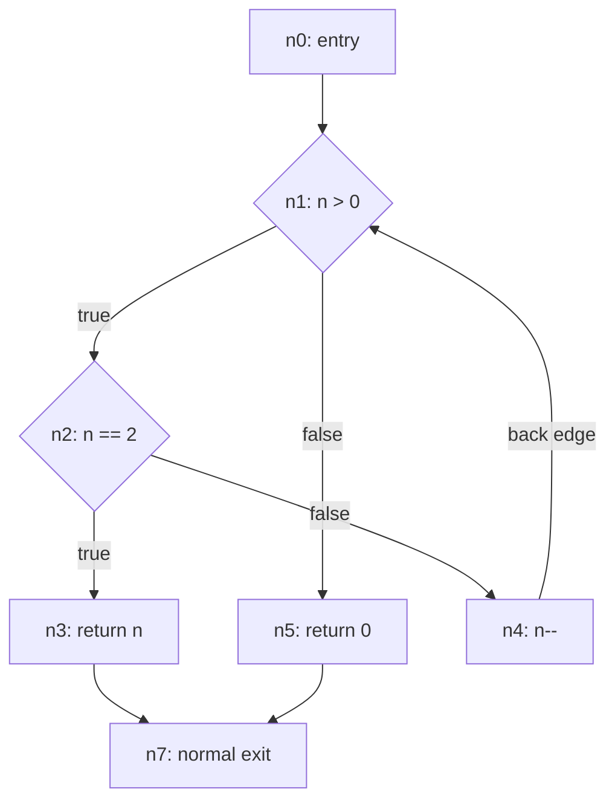

# Graph contracts and CCGraph profiles

## Versioned implementation targets

- [CCGraph strict matching profile](ccgraph-profile.md),
  `compat.ccgraph.strict/0.1.0`, and [machine settings](ccgraph-profile.json).
- [Rust HIR R0 extraction profile](rust-extraction-profile.md),
  `compat.rust.hir-r0/0.1.0`: strict acyclic, scalar-local, normal-flow subset.
- [Agreed design decisions](ccgraph-decisions.md) and
  [unimplemented capability/expansion backlog](rust-capabilities.md).
- [Matching stage expectations](fixtures/ccgraph-matching.json) and
  [Rust extraction expectations](fixtures/rust-r0-extraction.json). These use
  explicitly separate fixture formats, not the interchange schemas or analyzer
  snapshots. Exact results are hand-authored; producer observations remain not run.

The profiles are normative implementation specifications, not existing-engine
conformance, original-tool reproduction or measured clone quality. They resolve
paper ambiguities explicitly and preserve source evidence separately from the
matching view. Schema versions are unchanged; no `rstyle` implementation is replaced.

Run all structural and static contract-consistency tests:

```sh
uv run --no-project --with jsonschema python -m unittest discover -s schemas -p 'test_*.py'
```

`test_ccgraph_contract.py` checks settings, hand-worked arithmetic and fixture
reference/dominance/control/reaching-definition/merge consistency. These checks
are not a semantic producer validator, compiler run, detector conformance harness
or quality evaluation. Those are subsequent implementation acceptance gates.

## CFG schema and example

- [`cfg.schema.json`](cfg.schema.json): standalone JSON Schema Draft 2020-12
  structural contract, version `0.2.0`, with descriptions of fields and semantics.
- [`cfg.example.json`](cfg.example.json): a self-contained, hand-authored Go
  fixture with exact source text, a loop, a nested branch, and an early return.
  It illustrates the schema; it is not an extracted TinyPDG graph or a finalized
  Go extraction profile.

A CFG describes **possible immediate execution transfers**. Its successor edges
are not PDG control-dependence, data-dependence, or execution-dependence edges.
PDG construction additionally needs binding/definition/use facts, memory and
call assumptions, and a versioned dependence-analysis policy. This draft does
not supply those facts or select a postdominance algorithm.

### CFG representation

Each document represents one function and declares its construction profile,
producer, sources, entry, exits, nodes, edges, and extraction evidence. IDs are
opaque references, not matching labels. Source spans use half-open UTF-8 byte
offsets, consistent with the PDG draft below.

- `operation` granularity requires exactly one operation per non-boundary node.
  `basic_block` granularity allows execution-ordered operations with no internal
  branching; a condition or transfer must terminate its node.
- Entry and exit nodes are synthetic boundaries with no operations. Exit nodes
  identify normal, exceptional, or process termination. Multiple returns can
  share a normal exit; cleanup may introduce intermediate nodes.
- Nodes retain original operation kinds, source spans, display text, and origin
  explanations. This initial draft requires source-backed operations; fully
  synthetic lowered operations need a subsequent profile/schema extension.
- `true`/`false` and `case`/`default` edges retain branch outcomes. `normal` edges
  describe fallthrough or unconditional transfers. Abrupt transfers have distinct
  kinds (`return`, `break`, `continue`, `exception`, `terminate`). Parallel edges
  are permitted and retain separate IDs.
- Optional `loop_role` marks back edges and loop exits; it is not a dependency
  type. A back edge can have `kind: normal` or an appropriate branch outcome.
- Profiles must document evaluation order, exceptional-flow coverage, exit
  handling, and unreachable-code retention. Divergence stays cyclic; do not
  invent executable exit edges merely to make postdominance computation easier.
  Analysis-only virtual exits belong to a separate analysis policy.
- `complete` means flow is complete under the declared profile for this function,
  not that all language constructs are supported. Relevant omissions require
  `partial` evidence with reasons. Unknown evidence never means no flow.
- Nodes/edges are unordered collections; operations inside a node are ordered.
  Sort collections by ID for stable snapshots, not cross-producer equivalence.

### Machine-checkable evaluation-order policy

`profile.evaluation_order` is a closed object with three required fields:

```json
{
  "sequencing": "language_defined",
  "short_circuit": "explicit_branches",
  "unspecified_order": "reject"
}
```

- `sequencing` must be `language_defined`: honor the language's sequencing
  requirements rather than impose a universal left-to-right rule.
- `short_circuit` is `explicit_branches` or `reject`. Explicit branches preserve
  paths that skip conditionally evaluated operands; this includes conditional
  expressions where applicable. Rejection requires a diagnostic and `partial`
  or `unknown` extraction evidence when such a construct is encountered.
- `unspecified_order` is `overapproximate` or `reject`. Overapproximation must
  preserve every language-permitted relative evaluation order; additional paths
  are disclosed in limitations. Rejection requires a diagnostic and non-complete
  evidence when unspecified or indeterminately sequenced evaluations occur.
  Arbitrarily choosing one order is not supported.

These are policies, not per-function presence flags: the example can declare
`explicit_branches` even though it contains no short-circuit expression.
JSON Schema rejects missing fields, unsupported values, extra policy fields,
and the previous free-text representation. It cannot prove that branches or
ordering in the graph honor the policy; that requires language-aware semantic
validation and extraction fixtures. In particular, this schema does not yet
validate an all-orders graph encoding for unspecified evaluation order.

**Migration:** CFG version `0.2.0` replaces the `0.1.0` free-text
`evaluation_order` field with this object. Producers must explicitly choose
policies and update the schema version; do not infer choices from old prose.
The PDG schema remains at `0.1.0`.

Run the structural policy regression tests with:

```sh
uv run --no-project --with jsonschema python -m unittest discover -s schemas -p 'test_cfg_schema.py'
```

### Example topology

The embedded source tests `n > 0`, then `n == 2`. A true nested branch returns
immediately; otherwise `n--` transfers back to the loop predicate. A false loop
predicate reaches `return 0`. Both return edges lead to the same normal exit.
There is deliberately no edge from the early return to the decrement.



### CFG validation beyond JSON Schema

A semantic validator is still required to check:

1. Unique node, edge, operation, and source IDs in their respective namespaces;
   all node/source references resolve, including entry and exit IDs.
2. Exactly one entry node, no incoming entry edges, all exit nodes listed, no
   outgoing exit edges, and exit IDs referring only to exit nodes.
3. Span bounds and source content identity; function/operation source mappings
   must be consistent. Display text need not equal a span's exact source bytes
   when the profile permits normalized rendering.
4. Granularity, straight-line block ordering, predicate/transfer placement, and
   legal successor kinds and branch outcomes under the declared profile.
5. Reachability, loop annotations, cleanup paths, exceptional-flow coverage,
   short-circuit splitting, and unsupported-construct evidence through fixtures.
6. Completeness claims and profile requirements independently of producer claims.

The schema intentionally cannot prove these graph-wide conditions. Positive and
negative extraction fixtures and a reusable semantic validator remain follow-up
contract work. This CFG draft does not replace existing producer formats.

## PDG interchange draft

`pdg.schema.json` is a JSON Schema Draft 2020-12 structural contract, version
`0.1.0`. It is a starting point, not a finalized CCGraph profile or a claim that
existing Go/Rust producers conform. No existing graph format is replaced.

## Representation

- A document represents one function. IDs are opaque navigation/reference keys,
  never matching labels. Node and edge IDs are graph-local; symbol, definition,
  and memory-location IDs have separate document-local namespaces.
- Nodes represent operations or analysis entities. Symbols represent bindings;
  definitions represent individual produced versions of a binding or location.
  A reassignment must not reuse the previous definition ID.
- The extraction profile must define statement/expression/mixed granularity,
  scope identity, node category requirements, merge representation, and supported
  language constructs. `original_kind` retains frontend kinds separately from
  normalized categories. Source-backed nodes require spans; synthetic nodes
  require provenance and may also have spans.
- Spans use half-open UTF-8 byte offsets. Paths are navigation information;
  `content_identity` records known content identity or explicit missing evidence.
- The graph is a directed multigraph. Parallel edges are retained, including
  repeated operands. Edge IDs distinguish occurrences; arrays are not source
  order. Self-edges may be meaningful for loop-carried dependencies.
- Data edges run producer to consumer. Control edges run controller to controlled
  operation. Execution edges run prerequisite to constrained operation. Each edge
  names a versioned semantic policy; execution is not implicitly source order.
  CFG successor relations are not dependency edges and are not in the base edge
  enum. Export a separate CFG if required.
- `operand_position` is zero-based under the profile's operand ordering. Interface
  positions are zero-based within inputs/outputs. Receivers and captures have
  explicit roles; a profile must define their ordering and string serialization.
- Known facts carry values; unknown/unsupported/not-applicable facts carry reasons.
  A known count of zero differs from missing evidence. `reference_count` requires
  a versioned counting policy. `variadic` uses a boolean-valued fact; a known false
  value differs from unavailable evidence. R0 requires known nonvariadic elements.
- Capability descriptions must explain scope and approximations. Empty arrays do
  not establish absence: consult capability and interface completeness evidence.
  No schema default silently fills in an unknown fact.
- Namespaced annotations/extensions preserve effects, ownership, types, calls and
  additional facts. They do not affect base labels, filtering, or counts unless a
  named, versioned matching profile explicitly includes them.

## Semantic validation required beyond JSON Schema

Implement a validator alongside producer integration. It must check:

1. Unique IDs in each namespace and valid node/edge/symbol/definition/location/
   source references. Scope IDs must obey the extraction profile's scope model.
   Provenance origin IDs may refer to an external input graph only when a
   transformation profile defines that reference context.
2. Span bounds (`start <= end`, both within identified source bytes), source
   content identity, and source/provenance consistency.
3. Category-specific attributes: declarations identify bindings; reads identify
   accesses; assignments identify writes/definitions; computations identify
   operators; controls identify constructs/outcomes; calls identify resolution
   evidence; interface nodes identify positions; merges identify incoming values
   under the declared representation. The draft intentionally does not freeze
   these into a single frontend-independent extraction interpretation yet.
4. Definition ownership, legal dependency subtypes, operand positions, branch
   outcomes, and loop-carried facts according to the profile. Omitted optional
   edge attributes mean unrecorded, not false or zero.
5. Interface ordering and completeness; distinct definitions on reassignment;
   branch merges, loop-carried definitions, return and call dependencies using
   extraction fixtures, not just structural assertions.
6. Required profile capabilities and evidence. Missing required evidence must
   produce a diagnostic or `non_conformant`, never automatic conformance. A
   `conformant` claim must be checked rather than trusted. JSON Schema alone
   cannot prove completeness or correct reaching-definition analysis.

## Separate CCGraph matching profile

The [strict matching profile](ccgraph-profile.md) and
[machine settings](ccgraph-profile.json) now specify the initial interpretation.
The [decision record](ccgraph-decisions.md) preserves the agreed design direction.
None establishes current producer conformance.

Do not derive paper labels or features implicitly from schema categories: use the
profile's explicit mapping. The profile defines and versions:

- Projection/simplification rules and removed/collapsed node/edge provenance.
- Declaration/assignment/control/state/other categories, resolving the state/call
  terminology explicitly.
- Nine numerical features: `NumOfCtrlEdges`, `NumOfExcEdges`, `NumOfDataEdges`,
  `NumOfDeclNodes`, `NumOfAssignNodes`, `NumOfCtrlNodes`, `NumOfStateNodes`,
  `NumOfOtherNodes`, `NumOfReference`; counts before/after projection, multiplicity,
  and the reference-count policy.
- Three string features: `ReturnPara`, `IntroPara`, `Name`; parameter names/types,
  ordering, receivers, captures, separators, and unknown/empty behavior.
- Initial labels, dependency handling, optional annotations admitted into labels,
  and WL refinement/filtering policies.

Unknown reference counts or incomplete interfaces block a profile requiring
those features. Omitting execution edges is not paper fidelity.

## Serialization and deterministic comparison

Encode JSON as UTF-8. Object key order is irrelevant. Profiles must declare which
arrays are ordered (interfaces/operands) versus unordered collections
(nodes/edges/symbols). For stable snapshots, sort unordered collections by ID;
this is serialization stability, not graph equivalence across producers.

Cross-producer comparison must ignore navigation IDs/spans unless the test is
specifically about provenance. Compare graph structure with edge multiplicity,
operand roles, and profile-selected labels under an explicit node correspondence
or graph-equivalence procedure. For WL, compare label-equivalence partitions at
each iteration, not implementation-specific numeric hashes. Round-trip tests must
preserve facts, unknown evidence, parallel edges, and extension data.

## Next contract milestones

Implement the profiles' category/evidence constraints in a semantic validator and
materialize the independent expectations as schema-conformant inputs. Extend
positive/negative coverage (unknown evidence, branches, loops, calls, parallel
edges and invalid references) under the appropriate supported/deferred profiles.
Only then certify implementations against the named profile; empirical quality
requires the separate bounded labeled evaluation. Binary transport may follow
later if measurements justify it without changing these semantics.
